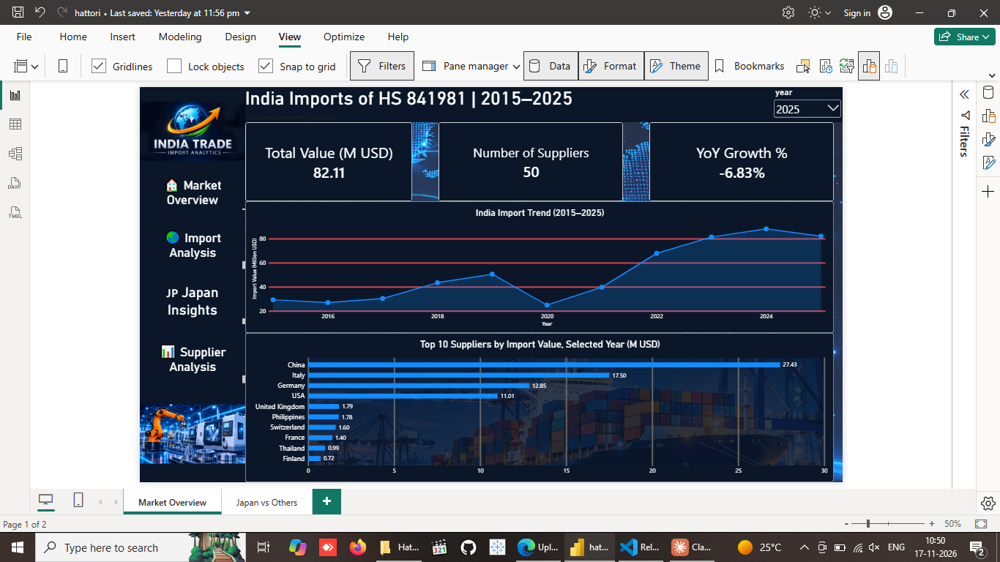
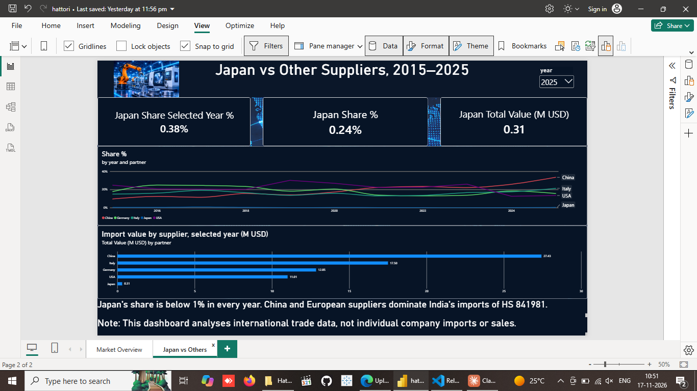

# India Commercial Kitchen Equipment Import Analysis (HS 841981), 2015-2025

An analysis of India's imports of machinery for making hot drinks or for cooking and heating food
(HS 841981), using public UN Comtrade data. It covers market growth, the main supplier countries
and Japan's position, with Python, SQL and a two-page Power BI dashboard.

**Tools:** Python (pandas), SQL (SQLite), Power BI

## Dashboard



## Why this project
India is a large and growing market for commercial kitchen equipment. I wanted to see who supplies it,
how fast it is growing and where Japan stands, using public trade data.

## Data
- Source: UN Comtrade (https://comtradeplus.un.org), downloaded on 11 Nov 2026
- Query: Reporter = India, Flow = Import, HS 841981, Partner = all, Annual, 2015-2025
- Raw file: 467 rows (456 partner rows plus 11 "World" total rows, one per year)
- The partner rows have 67 partner labels: 63 countries plus 4 labels that are not a single country
  (for example "Areas, nes" and India itself as a re-import). They are kept so the total matches
  the UN World total.
- HS 841981 is a broad category. It is a proxy for the commercial kitchen equipment market, not the
  exact products of any one company.
- This is public data. No company data was used.

## What I did
1. **Cleaning (Python):** renamed columns, checked duplicates and missing values, separated the
   "World" total from the partner rows, and checked that partner rows add up to the World total
   (difference of 1 USD or less in every year).
2. **Data quality findings:**
   - Every net-weight value is flagged as *estimated* by the UN (456 of 456 rows), so I did not use
     price per kg.
   - The HS edition changes over the years (HS2012 in 2015-2016, HS2017 in 2017-2021, HS2022 in
     2022-2025). Code 841981 exists in all of them, but long-term comparisons need care.
   - "Units" mix small and large machines, so value per unit shows product mix, not a pure price.
3. **SQL analysis:** yearly growth, top suppliers and shares, fastest-growing suppliers, Japan vs the
   top suppliers and supplier concentration (`sql/analysis.sql`).
4. **Power BI dashboard:** 2 pages, Market Overview and Japan vs Other Suppliers.

## Key findings
- India's imports grew from about 29.3M USD (2015) to about 82.1M USD (2025), a CAGR of about 10.9%.
- 2020 fell about 51% (COVID), then recovered strongly in 2021-2022. 2025 is about 7% below 2024.
- In 2025 the top 4 suppliers were China (33.4%), Italy (21.3%), Germany (15.7%) and USA (13.4%),
  together about 84%. The top 3 hold about 70%, so the market is concentrated.
- China's share rose from about 9.6% (2015) to about 33.4% (2025).
- Japan's share is below 1% in every year (highest 0.85% in 2017, 0.38% in 2025 at about 0.31M USD).
  Across 2015-2025 combined it is about 0.24%.

## Limitations
- Trade data shows what India imports, not why. It has no brand-level or customer-level detail.
- It cannot show product needs, such as gas or induction heating, or local food culture and
  purchasing preferences. That needs other research.
- China's 2025 quantity jumped about 8 times (about 0.43M to 3.4M units) while its value rose about
  21%. This may be a reporting or classification change, so I draw no conclusion from it.
- Small values (for example Japan's) can move a lot from year to year, so I do not read trends into them.

## How to run
```
pip install -r requirements.txt
python 01_clean.py
python 02_export_for_powerbi.py
python 03_run_sql.py
```
The Power BI dashboard uses `data/clean/imports_clean.csv` (all partner rows, so the total matches the UN World total).
`yearly_totals.csv`, `top_suppliers.csv` and `japan_vs_top.csv` are extra summary tables that include countries only,
so their totals are slightly lower (for example 81.7M instead of 82.1M USD in 2025).
